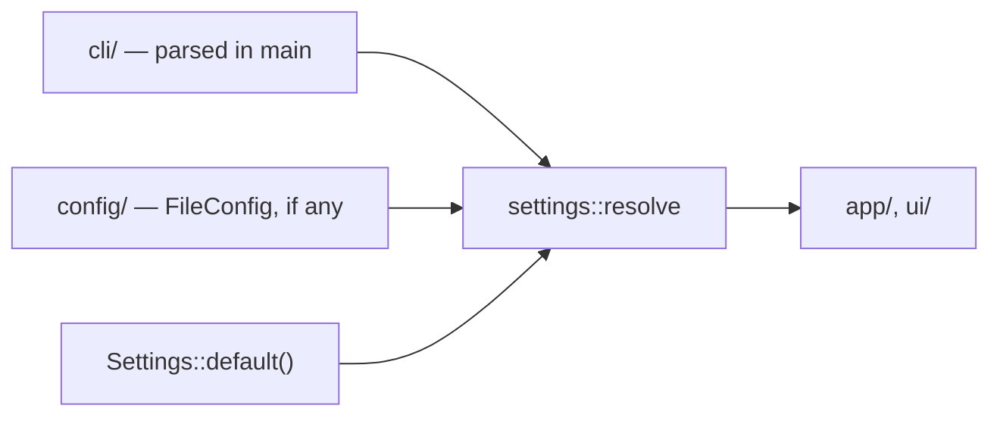

# Architecture

How projects made from this template are structured, and what must hold before any change
is committed. These are rules, not suggestions: "must" means a reviewer (or an audit) treats
a violation as a defect. When a rule doesn't fit a project, change this document in the same
commit and record why in [`DECISIONS.md`](DECISIONS.md).

The workspace's own code is the reference implementation: `libskel` and `skel` follow every
rule below, so copy their shape when adding a module.

---

## 1. Principles

### 1.1 Separation of concerns

Each module owns one responsibility, and the boundaries are explicit:

- **Library crates** hold domain logic, types and APIs: no CLI parsing, no process
  lifecycle, no config files, no UI rendering, no logging setup.
- **Binary crates** wire things together: parse the command line, resolve settings once,
  start logging, then hand off to the application layer.
- **Cross-cutting infrastructure** (logging, config loading, settings resolution) lives in
  its own modules, never mixed into business logic or UI code.

Don't reach across layers: a UI module doesn't read environment variables, a library
doesn't parse flags.

### 1.2 Slim `main`

`main.rs` is an entry point only. It:

1. Parses the command line (`cli/`).
2. Loads the config file (`config/`) and resolves `Settings` (`settings/`).
3. Starts logging from the settings (`logger/`).
4. Runs the application (`app/`) and turns the outcome into an exit code (§4.3).

Everything else belongs in modules.

### 1.3 Directory modules with sibling tests

Every module lives in its own folder, with its unit tests in a sibling file:

```text
src/
  feature/
    mod.rs      # implementation, ending its imports with `#[cfg(test)] mod tests;`
    tests.rs    # unit tests for this module (`use super::*;`)
```

Tests never live in the same file as production code. Integration tests go in the crate's
`tests/` directory. A module grows sub-modules as sub-folders with the same layout.

### 1.4 Cargo features for slim builds

Separate logical capabilities into optional Cargo features, so users can build or depend
on a slimmer package.

- **One feature per capability** (`network`, `json`, `tui`), not one catch-all `full`.
- **Heavy or niche dependencies** are `optional = true` behind their feature.
- **`default`** is the smallest useful set for typical use, not everything.
- Gate optional code at **module boundaries** with `#[cfg(feature = "...")]`; the module
  keeps the `mod.rs` + `tests.rs` layout, and its tests run only with the feature.
- A feature that needs another says so: `b = ["a"]`.
- The binary forwards library features: `extra = ["libskel/extra"]`.

Everything must build, lint and test at **three levels**: `--no-default-features`
(minimal), default, and `--all-features` (full). The gates (§11) run all three; a feature
isn't done until it passes them.

---

## 2. Repository layout

```text
AGENTS.md               # entry point for coding agents: map, rules, commands
CLAUDE.md               # Claude Code: imports AGENTS.md
README.md               # for users: what it is, install, usage, configuration
CHANGELOG.md            # Keep a Changelog; every change adds a line under Unreleased
Cargo.toml              # workspace: members, metadata, every dependency version, lints
deny.toml               # licenses, advisories, bans, sources
rust-toolchain.toml     # stable + rustfmt + clippy, for rustup users
.github/workflows/      # ci.yml (gates), release.yml (tags), advisories.yml (daily)
.claude/skills/         # Claude Code skills for the workflows in docs/agents/
scripts/                # gates.sh, stress.sh, coverage.sh, measure.py
examples/               # example config files, fixtures; each one tested (§7.5)
docs/
  ARCHITECTURE.md       # this file
  DECISIONS.md          # why things are the way they are (dependencies above all)
  PLAN.md               # the current plan and its progress, when there is one
  AUDIT.md              # the last audit's report, when there is one
  agents/               # how agents work here: WORKFLOW, PLANNING, AUDIT, RELEASE
  templates/            # PLAN.md and AUDIT.md skeletons
lib<name>/              # library crate
  src/
    lib.rs              # module list and re-exports only
    error/              # the crate's error type
    <module>/
      mod.rs
      tests.rs
<name>/                 # binary crate
  src/
    main.rs             # slim entry point (§1.2)
    cli/                # argument definitions (clap)
    config/             # TOML discovery, read, deserialize
    settings/           # cli > config > defaults → Settings
    logger/             # tracing subscriber setup
    app/                # application logic; sees Settings only
    ui/                 # interactive apps only (§4.1)
  tests/                # integration tests: run the real binary (§7.3)
```

Shared dependency versions live in `[workspace.dependencies]`, the internal library
included; crates use `name.workspace = true`. Every crate has `[lints] workspace = true`.

---

## 3. Settings resolution

All binaries resolve configuration through one pipeline. Raw CLI values and config-file
values never travel past the resolver.

### 3.1 Precedence

```text
command line  >  config file (TOML)  >  built-in defaults
```

Field by field: a flag overrides its key, a key overrides its default.

### 3.2 Flow



1. `main` parses the command line into `Cli`. This is the only place that happens.
2. `config/` finds and deserializes the file into `FileConfig` (every field `Option`). It
   applies no precedence.
3. `settings::resolve(&cli, file)` merges them over `Settings::default()` and returns a
   fully resolved `Settings`.
4. `logger::init` runs with the resolved settings.
5. From here on, only `Settings` is passed down. No function below the resolver takes
   `Cli`, clap types, or config paths.

### 3.3 Config files

- The format is **TOML**. A user-named path (`--config`) must exist; the default location
  (`dirs::config_dir()/<name>/config.toml`) is read only if present; `--no-config` skips it.
- Deserialization structs use `#[serde(deny_unknown_fields)]`: a typo is an error that names
  the key, never silently ignored. Errors name the file.
- `examples/config.toml` shows **every key with its default value**, and a test resolves it
  and compares with `Settings::default()`, so the example can't drift.
- Behaviour is configured by flags and the config file, not by environment variables
  (beyond the platform's own: `HOME`, XDG dirs).

---

## 4. User-facing binaries (CLI / TUI / GUI)

### 4.1 UI code

All UI code lives under `ui/`, one file per element (`header.rs`, `status_bar.rs`, ...), with
`tests.rs` alongside. Rendering, event handling and layout for a TUI or GUI belong there,
not in `app/` or `main.rs`. `app/` coordinates domain logic and UI but doesn't render.

### 4.2 Modules

| Module      | Responsibility                                               |
| ----------- | ------------------------------------------------------------ |
| `cli/`      | Argument and subcommand definitions; parsed only in `main`   |
| `config/`   | TOML discovery, read, deserialize                            |
| `settings/` | Merge cli + config + defaults → `Settings`                   |
| `logger/`   | `tracing` subscriber from `Settings`                         |
| `app/`      | The application: state, orchestration, I/O; writes to a `Write` it's given |
| `ui/`       | Interactive rendering and input                              |
| `commands/` | Subcommand handlers, one sub-folder each, when there are several |

### 4.3 Output and exit codes

- **stdout is for output** (what the user asked for); **stderr is for diagnostics** (logs,
  warnings, errors). Piping stdout must give clean data.
- `app::run` writes to an `impl Write` it's given, so tests capture output without a
  process. A closed stdout (`app | head`) is not an error: exit 0.
- Exit codes: `0` success, `1` the operation failed, `2` bad usage or a bad config file
  (clap uses 2 for usage errors too). Document any others in the README.
- Errors print as one line, `error: <message>`, naming the input or path that was wrong.

### 4.4 Interaction

- Prompts treat cancel (Esc) and interrupt (Ctrl-C) differently: cancel skips the
  question, interrupt stops the program. Without a terminal, a prompt is an error that
  points to the non-interactive flag; it never silently picks an answer.
- Every interactive choice has a flag for scripts (`--yes`, `--auto`).

---

## 5. Logging

Use the **`tracing`** ecosystem.

- `logger/` installs the subscriber once, from `Settings`, writing to stderr.
- Libraries emit events and spans; they never install subscribers.
- `println!` is for program output only, never for diagnostics.
- Levels: `error` (the operation failed), `warn` (suspicious, continuing), `info` (what
  happens), `debug` (how), `trace` (everything). Put identifiers and counts in fields.
- Never log secrets: tokens and keys are wrapped in a type whose `Debug`/`Display` redact.

---

## 6. Errors

- Each library has one error enum (`thiserror`), one variant per failure a caller can act
  on. Messages say what was wrong with which input: `cannot read /x/config.toml: ...`, not
  `IO error`.
- Binaries wrap library errors in their own enum (`#[from]`) and map them to exit codes in
  `main`.
- **No panic on input.** `unwrap`/`expect` only for invariants the code itself guarantees,
  and `expect`'s message states the invariant. Anything that comes from a file, the network,
  the user or another process is validated and returns an error.
- An operation that fails part-way leaves things as they were (§8.3).

---

## 7. Testing

### 7.1 Unit tests

- In `tests.rs` next to the module (§1.3). Test behaviour and edge cases, not
  implementation details.
- Every bug fix comes with a regression test that **fails without the fix**: check it by
  reverting the fix (`git stash push -- <file>`) and running the test.
- Feature-gated code is tested under its feature; tests compiled at every level must pass
  at every level (`cfg!(feature = "...")` for expectations that differ).

### 7.2 Determinism

- **No wall-clock assertions** and no `sleep` to wait for something: block on the event,
  inject a clock, or test the logic without time. A test that can be slow on a loaded
  machine will fail in CI.
- No dependence on test order, the current directory, the locale or the machine.
- New and changed tests must pass `scripts/stress.sh 20` (every test binary 20 times in
  parallel). A test that fails there is rewritten or removed, never retried.

### 7.3 Isolation

Tests must never touch the user's real files, services or network:

- Each test gets its own `tempfile::tempdir()`; no fixed paths under `/tmp`, nothing
  shared between tests.
- Code that writes outside its inputs (a trash dir, a cache) takes the location as a
  parameter, so tests point it into their temp dir.
- Integration tests run the real binary (`env!("CARGO_BIN_EXE_<name>")`) with
  `env_clear()` and `HOME`/`XDG_*` set to a temp dir.
- Network code is tested against a local mock server, never a live API.
- Tests that need real hardware or services are `#[ignore]`, with the reason in the
  attribute and a manual checklist in the docs.

### 7.4 Integration tests

In `<crate>/tests/`: the binary end to end, as a user runs it: exit codes, stdout and
stderr, config precedence, and the error paths.

### 7.5 Examples are tested

Every file under `examples/` is loaded by a test: example configs parse and match the
defaults, fixtures are used by the tests that need them.

### 7.6 Coverage

`scripts/coverage.sh` reports line and region coverage; CI shows it on every run. New
public API and every error path get tests. Coverage shouldn't drop; there's no percentage
target for its own sake.

---

## 8. Robustness and security

Recurring defects found by audits of projects built this way. Check new code against them.

### 8.1 Untrusted input

- **Sizes and counts from outside are never trusted**: don't allocate, loop or recurse by
  a number taken from a file, a header or the user without a bound. Clamp ranges to what
  exists.
- **Text that reaches the terminal** (names, descriptions, error messages quoting a
  server) has control characters replaced, or is rejected where it enters: an escape
  sequence can set the title, write the clipboard or hide text.
- **Paths from outside** (archive entries, config values, names from a server) are
  checked to stay inside the directory they belong to before anything is written or
  removed.
- **Encodings**: text files may have a BOM or not be UTF-8; read bytes and decode lossily
  when the content is informational.

### 8.2 Logic

- Boolean filters with negation: `!(a == x && b == y)`, not `a != x && b != y`.
  Test both halves.
- Empty input (an empty archive, an empty list, a missing section) is an error or a
  deliberate no-op, never a silent "success" that did nothing.
- Lookups that "can't fail" in maps built from external data return an error when they do.

### 8.3 Files and processes

- Write files **atomically**: write a temporary file in the same directory, then rename.
- **Prepare, then commit**: an operation that replaces something builds the new version
  completely (extract, download, compute) before touching the old one.
- Temporary files are deleted when the operation ends (a drop guard), and caches have an
  eviction or a clean command.
- Moving across filesystems is a copy: don't put large data in `/tmp` (often RAM) or
  shared directories other users can create first.
- External commands get arguments as a list, never through a shell string.

### 8.4 Secrets and network

- Secrets come from the config file or a credential helper, are redacted in `Debug` and
  logs, and are sent only to the host they belong to.
- Network calls have timeouts; retries are bounded; downloads are checked (size, checksum
  when the source publishes one).

---

## 9. Performance

- **Measure before and after** any change meant to be faster, and any change to a hot path:
  `scripts/measure.py` gives median and minimum time and peak memory for commands. Put the
  numbers in the commit message (and the audit report).
- Optimize what a measurement shows matters. Prefer streaming over loading whole files,
  borrowing over cloning in loops, and one pass over many.
- Allocations sized by input must be bounded (§8.1).
- Release builds are stripped (`[profile.release]`). Note binary size when adding a
  dependency.

---

## 10. Dependencies

### 10.1 Latest versions

Use the latest stable release of every dependency; versions live in
`[workspace.dependencies]`. Dependabot proposes updates weekly; apply them once CI passes.

### 10.2 Active crates only

A dependency is acceptable only when **all** of these hold:

- Its latest release is **within the past year**.
- Its repository is **not archived**.
- It has no RustSec advisory, `unmaintained` included, without an upgrade
  (`cargo deny check` passes).

Prefer std and existing dependencies. Every new dependency gets an entry in
[`DECISIONS.md`](DECISIONS.md): what it's for, the alternatives, its weight. Enable only the
features you use (`default-features = false` where the defaults are heavy).

### 10.3 Enforcement

- `deny.toml`: allowed licenses, advisories, wildcard and source bans.
- `cargo deny check` is a gate (§11), and `.github/workflows/advisories.yml` runs the
  advisory check daily, because new advisories appear without any push.

---

## 11. Quality gates: required before every commit

`scripts/gates.sh` runs them all; CI runs the same script, one step per job.

| Gate | Command |
| ---- | ------- |
| Formatting | `cargo fmt --all -- --check` |
| Spelling | `typos` |
| Licenses, advisories, sources | `cargo deny check` |
| Clippy ×3 levels | `cargo clippy --workspace --all-targets <level> -- -D warnings` |
| Tests ×3 levels | `cargo test --workspace <level>` |
| Documentation | `RUSTDOCFLAGS="-D warnings" cargo doc --workspace --no-deps --all-features` |

Levels: `--no-default-features`, none, `--all-features`. One step at one level:
`scripts/gates.sh clippy full`.

Also, outside the gates:

- `scripts/stress.sh 20` on every commit that adds or changes tests (CI runs 10).
- `scripts/coverage.sh` before and after larger changes.

A gate that fails is fixed, never skipped. If the failure predates the change (a new
advisory, a new clippy lint), fix it in its own commit first.

---

## 12. Documentation and changelog

Docs are part of the change that makes them true:

- **README.md**: what the program does, install, usage, configuration, exit codes.
- **CHANGELOG.md**: every user-visible change gets a line under `## [Unreleased]`, in
  Added / Changed / Deprecated / Removed / Fixed / Security. Write for users: what changed
  for them, not which function. No release date until a release (docs/agents/RELEASE.md).
- **docs/**: anything a user or contributor needs beyond the README; this file when a rule
  changes; `DECISIONS.md` when a choice is made.
- **examples/**: kept in sync by tests (§7.5).
- Public items have doc comments (`missing_docs` warns, and the gates deny warnings);
  `# Errors` sections on fallible public functions.

---

## 13. Versioning

- Semantic versioning. Before 1.0, a breaking change bumps the minor version.
- One version for the workspace, in `[workspace.package]` and in the internal crate's
  `[workspace.dependencies]` entry.
- The version is bumped by the release flow (docs/agents/RELEASE.md), in its own commit.

---

## 14. Crate boundaries

| Layer | Responsibility | Typical dependencies |
| ----- | -------------- | -------------------- |
| **Library** | Domain types, algorithms, protocols, I/O on paths it's given | `thiserror`, `tracing` (events), `serde` if needed |
| **Binary** | CLI, config, settings, logging, app wiring, UI | the library, `clap`, `toml`, `dirs`, `tracing-subscriber`, UI crates |

Forbidden crossings:

- Libraries don't depend on `clap`, UI frameworks or subscriber setup, and don't read
  config files or environment variables.
- `app/` and `ui/` don't parse the command line or read config files.
- Library tests don't need the binary.

---

## 15. Checklist for every change

- [ ] Modules are folders with `mod.rs` + `tests.rs`; `main.rs` stays slim.
- [ ] Only `Settings` passes below the resolver; config structs deny unknown fields.
- [ ] Optional capabilities are features; all three levels pass.
- [ ] Errors name their input; nothing panics on input (§6, §8).
- [ ] Tests: behaviour and errors covered, isolated (§7.3), deterministic, stress-run;
      bug fixes have a regression test that fails without the fix.
- [ ] Performance-relevant changes have before/after numbers (§9).
- [ ] New dependencies are current, maintained, justified in `DECISIONS.md`.
- [ ] README, docs, examples and CHANGELOG match the change.
- [ ] `scripts/gates.sh` passes.
